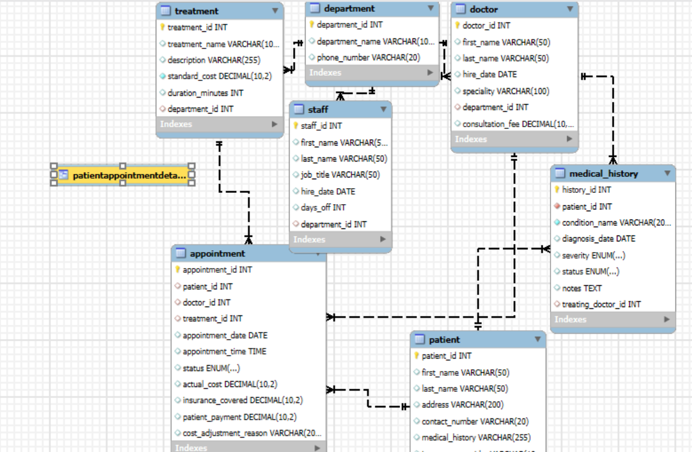
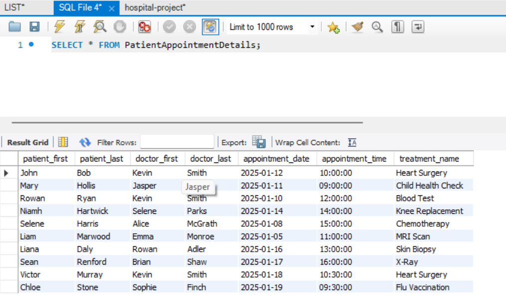
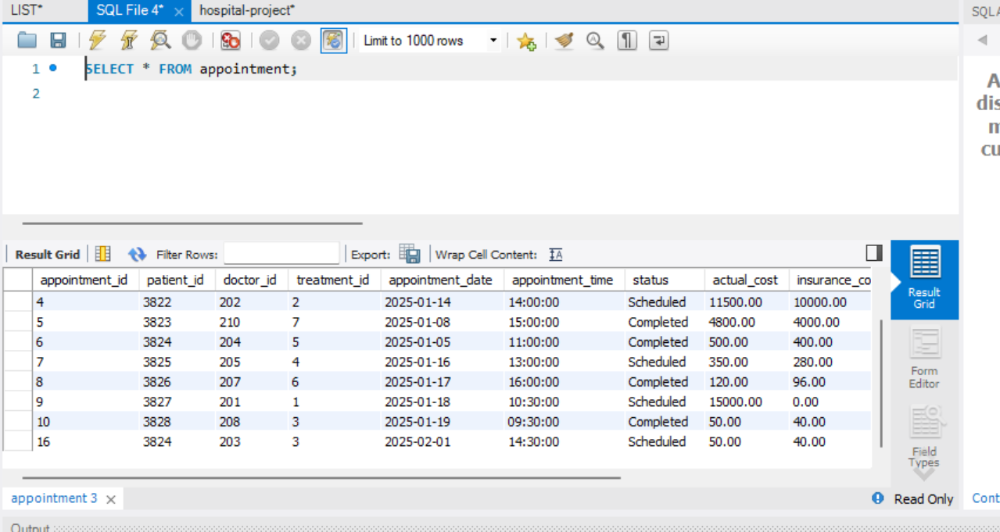
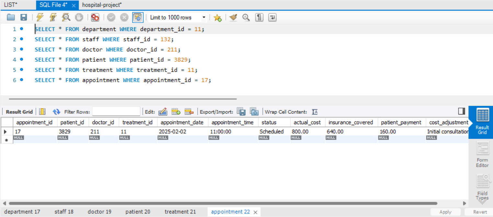

# Hospital Database System

A relational database for a hospital, designed and built in MySQL for the **Database Fundamentals** module (COMP H1029) at TU Dublin, Nov 2025.

**Individual project:** I did all of the design, SQL, testing and documentation myself.

---

## Purpose

Hospitals need to keep track of patients, staff, doctors, treatments, appointments and medical history. They also need to keep that data accurate when records change. The goal was to design a normalised database that supports those day-to-day tasks, then prove it works with a set of business queries.

## What I built

| Part | Details |
|---|---|
| **Design** | 7 related tables: `department`, `staff`, `doctor`, `patient`, `treatment`, `medical_history`, `appointment`, normalised to **3NF** |
| **ER diagram** | Modelled in MySQL Workbench ([`docs/hospital-diagram.mwb`](docs/hospital-diagram.mwb)) |
| **Integrity** | Primary and foreign keys, `ENUM` constraints (appointment status, severity), `NOT NULL` rules, `ON DELETE CASCADE` for medical history |
| **Data** | 60 sample records across six tables (all fictional) |
| **Queries** | 20 SQL queries: lookups, updates, inserts, deletes, multi-table `JOIN`s, aggregates and a `VIEW` |

## Technologies

MySQL · MySQL Workbench · SQL (DDL and DML) · ER modelling · Normalisation (1NF → 3NF)

## ER diagram



## Example queries

```sql
-- Patients with a diabetes diagnosis (JOIN)
SELECT p.* FROM patient p
JOIN medical_history mh ON p.patient_id = mh.patient_id
WHERE mh.condition_name = 'Diabetes';

-- A reusable view combining patients, doctors and treatments
CREATE VIEW PatientAppointmentDetails AS
SELECT p.first_name AS patient_first, p.last_name AS patient_last,
       d.first_name AS doctor_first, d.last_name AS doctor_last,
       a.appointment_date, a.appointment_time, t.treatment_name
FROM appointment a
JOIN patient p ON a.patient_id = p.patient_id
JOIN doctor d ON a.doctor_id = d.doctor_id
LEFT JOIN treatment t ON a.treatment_id = t.treatment_id;
```

All 20 queries are in [`sql/queries.sql`](sql/queries.sql).

## Evidence

| | |
|---|---|
| Output of the `PatientAppointmentDetails` view |  |
| Appointment table after inserts |  |
| Checking new records across 6 tables after an insert |  |

- Full project report (design, business rules, normalisation, every query with screenshots): [`docs/DBF_project_report.pdf`](docs/DBF_project_report.pdf)
- Query screenshots: [`docs/QUERIES.pdf`](docs/QUERIES.pdf)

## How to run it

1. Open MySQL Workbench (or any MySQL 8 client).
2. Run [`sql/hospital-project.sql`](sql/hospital-project.sql). It creates the `hospital_project` database, all tables and the sample data.
3. Run the queries in [`sql/queries.sql`](sql/queries.sql) one at a time. **Q20 deletes all appointments**, so run it last.

## Outcome and what I learned

- Turned business requirements into entities, relationships and rules, then into a working schema.
- Learned how normalisation removes duplicated data and how foreign keys and cascades keep records consistent.
- Practised writing and testing SQL, from simple lookups to joins across several tables and views.

---

[← Back to my portfolio](https://github.com/Dani-Kunda)
